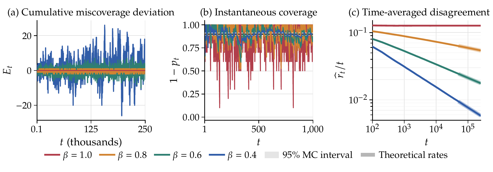
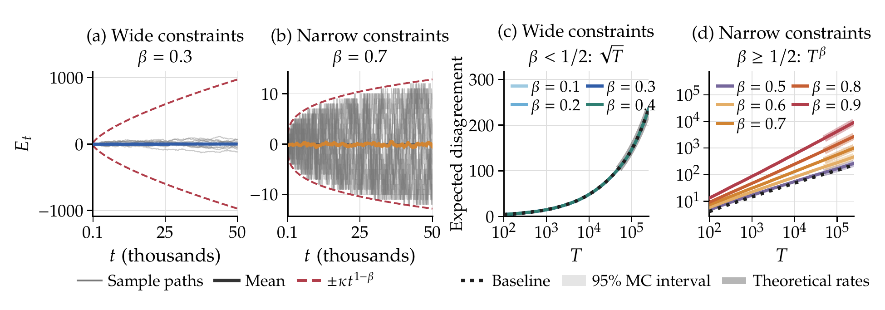
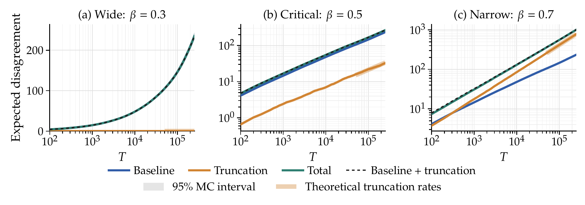
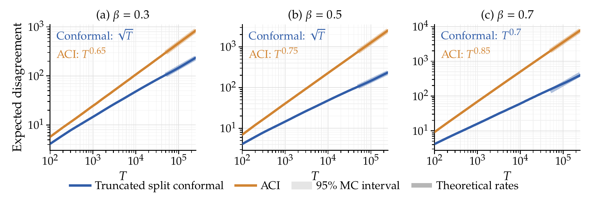

# The cost of enforcing long-run coverage

Code for **The cost of enforcing long-run coverage: a phase transition in online conformal prediction**, by Yu Gui, Rina Foygel Barber, and Cong Ma.

[Paper on arXiv](https://arxiv.org/abs/2611.21542)

In online uncertainty quantification, enforcing long-run empirical coverage can compromise instantaneous coverage, even on i.i.d. data. We characterize the sharp phase transition governing this trade-off and give a simple *best-of-both-worlds* method that attains the minimax-optimal rate.

We study algorithms that satisfy

$$
\left|\frac{1}{T}\sum_{t=1}^{T}(\mathrm{err}_t^{\mathcal C}-\alpha)\right|
\leq \kappa T^{-\beta}
\qquad\text{for every }T\geq 1
$$

on every data sequence, where $\mathrm{err}_t^{\mathcal C}=\mathbf{1}\{Y_t\notin\mathcal C_t(X_t)\}$ indicates miscoverage. Here $\alpha\in(0,1)$, $\beta\in[0,1]$, and $\kappa\geq 1/2$. Larger $\beta$ requires tighter control of long-run empirical coverage.

## Main result

Fix a measurable score $s$, and let $\mathcal Q$ be the nonempty class of all i.i.d. laws under which $s(X,Y)$ has a nonatomic distribution. For each $P\in\mathcal Q$, we compare the algorithm with an oracle whose coverage given the past is exactly $1-\alpha$, almost surely at every round:

$$
P\!\left(Y_t\in\mathcal C^*_{P,t}(X_t)\mid\mathcal G_{t-1}\right)=1-\alpha,
\qquad
\mathcal G_{t-1}=\sigma\!\left((X_r,Y_r)_{r<t}\right).
$$

The oracle may know $P$; the algorithm does not. Both construct their prediction sets as deterministic measurable functions of past observations and the current feature. Their cumulative disagreement counts responses that belong to exactly one of the two sets:

$$
\ell_T(\mathcal C,\mathcal C^*_P)
=\sum_{t=1}^{T}\left|\mathrm{err}_t^{\mathcal C}-\mathrm{err}_t^{\mathcal C^*_P}\right|.
$$

Let $\mathcal A_{\beta,\kappa}$ denote algorithms satisfying the long-run coverage constraint, and let $\mathcal O_\alpha(P)$ denote the exact oracles above. The minimax expected disagreement is

$$
\begin{aligned}
\inf_{\mathcal C\in\mathcal A_{\beta,\kappa}}
\sup_{P\in\mathcal Q}
\inf_{\mathcal C^*_P\in\mathcal O_\alpha(P)}
\mathbb E_P\!\left[\ell_T(\mathcal C,\mathcal C^*_P)\right]
&\asymp T^{\max\{1/2,\beta\}}\\[4pt]
&=
\begin{cases}
\sqrt T, & 0\leq\beta\leq \tfrac12,\\[2pt]
T^\beta, & \tfrac12<\beta\leq 1.
\end{cases}
\end{aligned}
$$

The notation $\asymp$ means equality up to positive constants for sufficiently large $T$. Learning the unknown distribution costs order $\sqrt T$. The coverage constraint preserves this rate for $\beta\leq 1/2$ and raises it to $T^\beta$ for $\beta>1/2$.

**Truncated split conformal prediction** attains this rate. It keeps the baseline prediction set whenever both possible outcomes respect the constraint. Otherwise, it outputs the full response space or the empty set to force coverage or miscoverage.

For comparison, consider **adaptive conformal inference (ACI)** with a fixed score in $[0,B]$, an initial threshold $q_1\in[0,B]$, and steps $\eta_t=ct^{-(1-\beta)}$, where $B,c>0$ and $0<\beta<1$. It satisfies the same constraint with $\kappa=(B+c)/c>1$. Under i.i.d. sampling, if the score density is bounded above and away from zero almost everywhere on $[0,B]$, then

$$
\inf_{\mathcal C^*_P\in\mathcal O_\alpha(P)}
\mathbb E_P\!\left[\ell_T(\mathcal C^{\mathrm{ACI}},\mathcal C^*_P)\right]
\asymp T^{(1+\beta)/2},
\qquad
\frac{1+\beta}{2}>\max\!\left\{\frac12,\beta\right\}.
$$

Thus ACI accumulates disagreement faster than truncated split conformal prediction under the same long-run coverage guarantee.

## Repository

```text
methods/                   One Python implementation per method
  split_conformal.py       Split conformal prediction
  truncated.py             Truncation of a baseline prediction set
  aci.py                   Quantile-threshold ACI
simu/
  dgp.py                   Data-generating process and score
  run.py                   Simulation, summaries, and numerical checks
  validate.py              Independent checks of the simulation engine
  output/                  Generated simulation data
figure/
  figure1_aci.py            ACI motivation
  figure2_conformal.py      Coverage paths and oracle disagreement
  figure3_decomposition.py  The cost of truncation
  figure4_comparison.py     ACI and truncated split conformal prediction
  paper/                   Original paper figures and README previews
  output/                  Generated figures and plotted values
```

The Python methods expose the algorithms directly. The simulation uses a C++ engine for the full experiment and checks its predictions against the Python implementations.

## Reproduce

Requirements: Python 3.10 or later and a C++17 compiler (`c++`, or set `CXX`). From this directory:

```sh
python -m pip install -r requirements.txt
python -m simu.run --profile smoke
python -m simu.run --profile paper --workers 4
python -m figure
```

The smoke run checks the implementation on a smaller experiment. The paper run uses 500 independent replications and 250,000 rounds. Completed simulation chunks are reused after their parameters and hashes have been checked.

Each figure also has an end-to-end command. It generates the paper data if needed, then writes PDF, SVG, PNG, and plotted values to `figure/output/`:

```sh
python -m figure.figure1_aci
python -m figure.figure2_conformal
python -m figure.figure3_decomposition
python -m figure.figure4_comparison
```

LaTeX is optional. With the paper's LaTeX fonts installed, the plots use `newpxtext` and `newpxmath`; otherwise they use Matplotlib's built-in text rendering. See [REPRODUCIBILITY.md](REPRODUCIBILITY.md) for parameters, output files, and checks.

## Numerical experiments

We use the heteroscedastic regression model

$$
X_t\sim\mathrm{Unif}[0,1],\qquad
Y_t=\sin(2\pi X_t)+(0.2+0.3X_t)\varepsilon_t,\qquad
\varepsilon_t\sim\mathrm{Unif}[-1,1],
$$

independently over time, with $X_t$ and $\varepsilon_t$ independent. The fixed score is the clipped absolute standardized residual, which is uniform on $[0,1]$. We set $\alpha=0.1$ and compare with the population prediction set having score threshold $0.9$.

The figures below are from the paper; click a figure to open its PDF.

[](figure/paper/aci_motivation_R.pdf)

**Figure 1.** ACI with constant and decaying step sizes. Tighter control of long-run empirical coverage comes with larger fluctuations in instantaneous training-conditional coverage and greater oracle disagreement.

[](figure/paper/simulation_conformal.pdf)

**Figure 2.** Truncated split conformal prediction with $\kappa=0.5$. Cumulative deviations stay within the prescribed bounds, and oracle disagreement is consistent with the phase transition at $\beta=1/2$.

[](figure/paper/simulation_decomposition.pdf)

**Figure 3.** The cost of truncation for $\beta=0.3,0.5,0.7$ and $\kappa=0.5$. Below the transition, total disagreement remains close to the baseline; above it, the truncation cost dominates.

[](figure/paper/simulation_aci_comparison.pdf)

**Figure 4.** ACI and truncated split conformal prediction under the same $(\beta,2)$ guarantee. Their estimated cumulative disagreements are consistent with the respective rates $T^{(1+\beta)/2}$ and $T^{\max\{1/2,\beta\}}$.

## Citation

```bibtex
@article{gui2026cost,
  title = {The cost of enforcing long-run coverage: a phase transition in online conformal prediction},
  author = {Gui, Yu and Barber, Rina Foygel and Ma, Cong},
  journal = {arXiv preprint arXiv:2611.21542},
  year = {2026}
}
```
